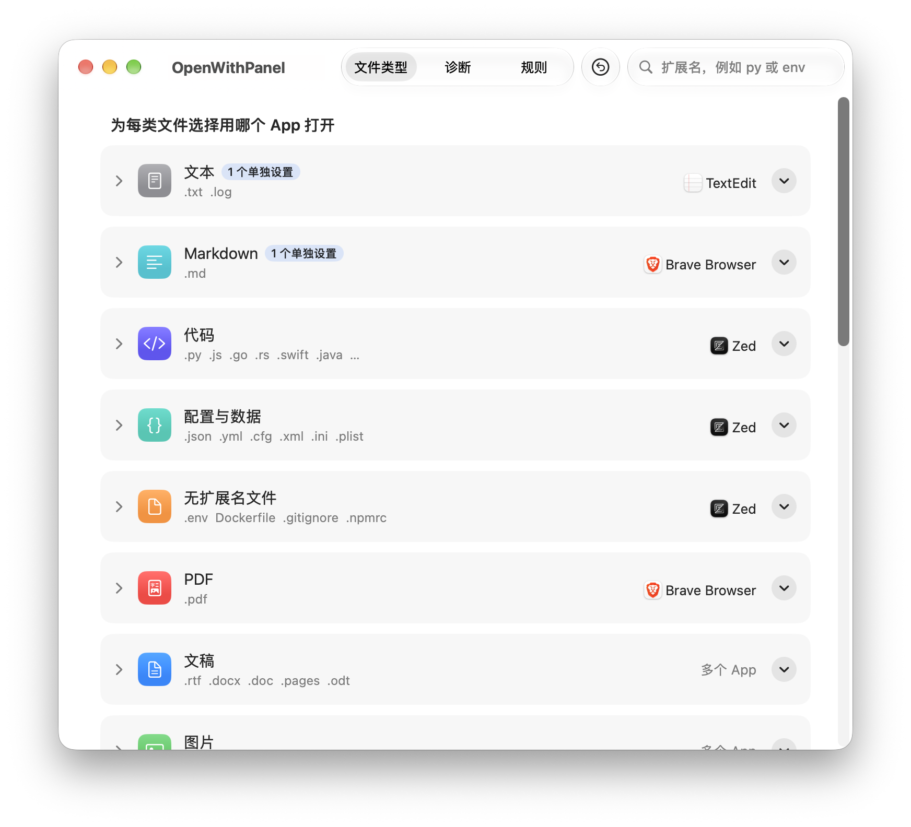
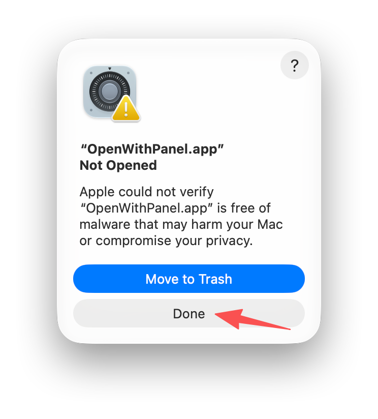
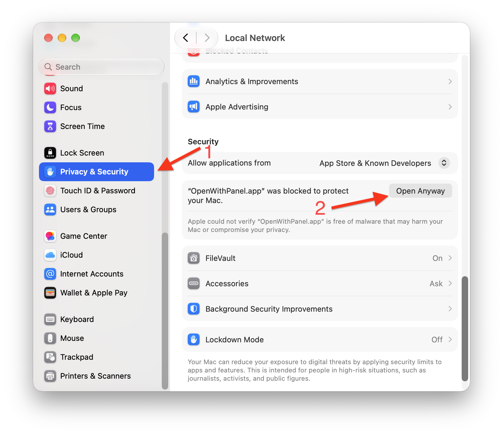
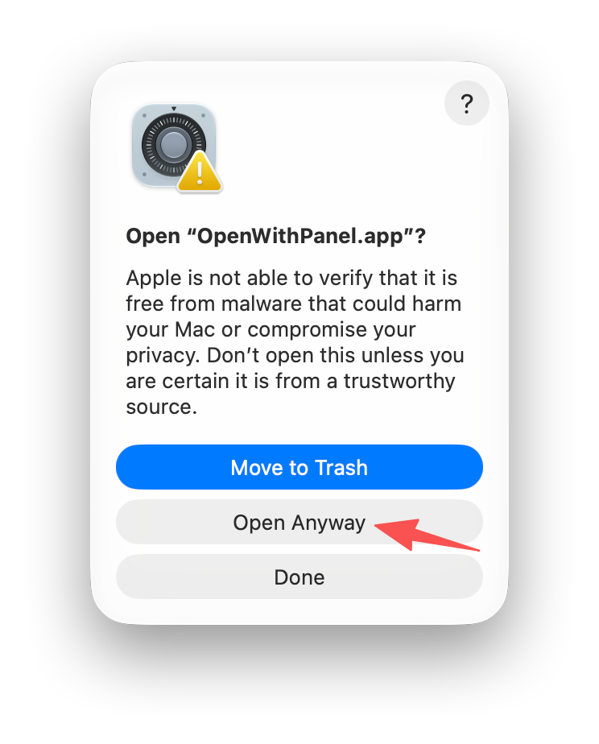

<p align="center">
  
</p>

<h1 align="center">OpenWithPanel</h1>

<p align="center">
  <strong>Выбирайте, какое приложение открывает какие файлы на Mac, — даже те, для которых macOS этого не позволяет.</strong>
</p>

<p align="center">
  
  
  
</p>

<p align="center">
  <a href="../../README.md">English</a> ·
  <a href="README.zh-Hans.md">简体中文</a> ·
  <a href="README.zh-Hant.md">繁體中文</a> ·
  <a href="README.ja.md">日本語</a> ·
  <a href="README.ko.md">한국어</a> ·
  <a href="README.de.md">Deutsch</a> ·
  <a href="README.fr.md">Français</a> ·
  <a href="README.es.md">Español</a> ·
  <a href="README.pt.md">Português</a> ·
  <a href="README.id.md">Bahasa Indonesia</a> ·
  <a href="README.th.md">ไทย</a> ·
  <a href="README.vi.md">Tiếng Việt</a> ·
  <a href="README.ar.md">العربية</a> ·
  <b>Русский</b> ·
  <a href="README.hi.md">हिन्दी</a>
</p>

OpenWithPanel — бесплатное приложение для macOS с открытым исходным кодом для управления **приложениями по умолчанию**: в одном окне можно выбрать, чем открывать каждый тип файлов, каждое расширение и каждую ссылку. Кроме того, оно умеет то, чего не может Finder: назначить ваш редактор приложением по умолчанию для **файлов без расширения**, таких как `.env`, `.gitignore`, `Dockerfile` и `.npmrc`.

<p align="center">
  
</p>

## Содержание

- [Зачем нужен OpenWithPanel](#зачем-нужен-openwithpanel)
- [Возможности](#возможности)
- [Установка](#установка)
- [Использование](#использование)
- [Диагностика](#диагностика)
- [Настройки](#настройки)
- [Режим разработчика](#режим-разработчика)
- [Как это работает](#как-это-работает)
- [Частые вопросы](#частые-вопросы)
- [Известные ограничения](#известные-ограничения)
- [Сборка из исходного кода](#сборка-из-исходного-кода)

## Зачем нужен OpenWithPanel

macOS относит большинство файлов без расширения к типу `public.data` и не позволяет назначить для этого типа приложение по умолчанию. Команда Finder **Свойства › Открыть в приложении › Изменить все…** на такие файлы не действует, а инструменты командной строки завершаются с ошибкой `-50`. Пункт Finder **Всегда открывать в приложении** применяется только к одному выбранному файлу.

Поэтому `.env`, `.gitignore`, `Dockerfile` и похожие файлы по-прежнему открываются в TextEdit — или не открываются вовсе, — что бы вы ни настроили. OpenWithPanel решает эту проблему с помощью небольшого вспомогательного приложения OpenWithPanel Helper, о котором рассказано в разделе [Как это работает](#как-это-работает).

OpenWithPanel закрывает и другие пробелы macOS: когда только что установленное приложение (обычно Xcode) перехватывает ваши связи файлов, macOS об этом не сообщает, и кнопки, чтобы вернуть всё как было, нет.

## Возможности

- **Приложения по умолчанию по группам.** Типы файлов сгруппированы по назначению — Текст, Markdown, Код, Конфигурация и данные, Файлы без расширения, PDF, Документы, Изображения, Видео, Аудио, Архивы, — и у каждой группы одно меню выбора приложения.
- **Применение за один раз.** Настройте сразу целую группу форматов, не подтверждая каждый; изменения вступают в силу за несколько секунд.
- **Исключения для отдельных форматов.** Разверните группу, чтобы назначить отдельному формату, например `.md` или `.py`, собственное приложение. Если потом сменить приложение группы, исключения останутся как есть.
- **Файлы без расширения.** Открывайте `.env`, `Dockerfile`, `.gitignore` и другие файлы без расширения в выбранном редакторе, даже если этот редактор не объявляет их поддержку.
- **Свои расширения.** Добавляйте любые расширения, которых нет в списке, в том числе те, что macOS знает только как временные типы, например `.go`, `.rs`, `.kt`, `.dart` и `.lua`.
- **Приложения по умолчанию для ссылок.** Выберите приложение для веб-ссылок (`http`, `https`), электронной почты (`mailto`), подписок на календари (`webcal`), звонков, SMS, FaceTime, SSH, FTP и общего экрана — или выберите **Не открывать**, чтобы щелчок по такой ссылке ничего не делал.
- **Поиск по расширению.** Введите `py` или `env`, чтобы сразу перейти к нужной строке.
- **Диагностика любого файла.** Перетащите файл, чтобы узнать, почему он открывается в определённом приложении, и тут же выбрать другое. Перетащите папку, чтобы найти файлы с собственной настройкой **Открыть в приложении** и сбросить её.
- **Оповещения о перехвате.** Если другое приложение (Xcode, браузер) перехватит заданную вами связь, OpenWithPanel покажет баннер с исправлением в один щелчок.
- **Отмена и восстановление.** Перед каждым изменением сохраняется снимок. Отменяйте с помощью `⌘Z`, восстанавливайте любой более ранний снимок или верните всё к состоянию до любых изменений OpenWithPanel — с предварительным просмотром каждого изменения.
- **Правила папок.** Необязательный запасной вариант: файлы без расширения в выбранных папках, например `~/Projects`, открываются в вашем редакторе; используются только официальные API macOS.
- **Режим разработчика.** Правила, направляющие файлы по шаблону имени (например, `Dockerfile*`), папке или содержимому (текст или двоичные данные); полная цепочка решений в диагностике, включая объявленные каждым приложением типы и их ранг; импорт и экспорт наборов настроек.
- **Чистое удаление.** Встроенный деинсталлятор возвращает каждую связь исходному приложению, прежде чем переместить OpenWithPanel в Корзину.
- **15 языков.** Английский, китайский (упрощённый), китайский (традиционный), японский, корейский, немецкий, французский, испанский, португальский, индонезийский, тайский, вьетнамский, арабский, русский и хинди; язык переключается прямо в приложении.

## Установка

Требуется macOS 26 Tahoe или новее.

1. Откройте [страницу Releases](https://github.com/zhaojiannet/openwithpanel/releases) и в разделе **Assets** последнего выпуска скачайте `OpenWithPanel-<version>.dmg`.
2. Дважды щёлкните скачанный DMG, чтобы открыть его.
3. Перетащите **OpenWithPanel** на папку **Программы**, показанную в том же окне.
4. Извлеките DMG, затем откройте OpenWithPanel из папки «Программы». При первом запуске macOS попросит разрешить его; см. [Первый запуск](#первый-запуск).

Установщика нет, пароль администратора не нужен.

**Обновление:** скачайте новый DMG и снова перетащите OpenWithPanel в папку «Программы», заменив старую копию. Ваши настройки, правила и снимки сохранятся.

**Удаление:** см. [Удаление](#удаление).

### Первый запуск

OpenWithPanel пока не заверен Apple, поэтому macOS блокирует его при первом открытии. Разрешите его один раз:

1. Дважды щёлкните OpenWithPanel. Когда macOS сообщит, что не удалось проверить OpenWithPanel, нажмите **Готово**. Не нажимайте синюю кнопку **Переместить в Корзину**.

   

2. Откройте **Системные настройки › Конфиденциальность и безопасность**, прокрутите вниз до раздела **Безопасность** и нажмите **Все равно открыть** рядом с OpenWithPanel. Кнопка доступна примерно в течение часа после шага 1.

   

3. Введите пароль для входа или воспользуйтесь Touch ID. В появившемся окне снова нажмите **Все равно открыть**.

   

После этого OpenWithPanel открывается как обычно. Встроенный помощник получает разрешение вместе с ним, поэтому файлы без расширения открываются без дополнительных запросов. Эти же шаги есть в DMG, в файле `First Launch.txt`. На снимках экрана показан английский интерфейс; в русской macOS кнопки называются так, как написано выше.

## Использование

### Группы типов файлов

На вкладке **Типы файлов** каждая группа показана карточкой:

| Группа | Что входит |
|---|---|
| Текст | `.txt` `.log` |
| Markdown | `.md` `.markdown` |
| Код | Популярные языки программирования, см. ниже |
| Конфигурация и данные | `.json` `.yaml` `.toml` `.xml` `.ini` `.plist` `.csv` |
| Файлы без расширения | `.env` `Dockerfile` `.gitignore` и подобные |
| PDF | `.pdf` |
| Документы | `.rtf` `.docx` `.doc` `.pages` `.odt` |
| Изображения, Видео, Аудио, Архивы | Их распространённые форматы |
| Свои | Добавленные вами расширения, не подходящие ни к одной другой группе; группа видна, только если такие есть |

Группа «Код» охватывает языки, которыми пользуются не менее 5% участников опроса разработчиков Stack Overflow 2025: JavaScript, TypeScript (`.tsx`), Python, Java, C, C++, C#, PHP, Ruby, Swift, Go, Rust, Kotlin, Dart, Lua, Shell (sh, bash, zsh), PowerShell, SQL и ассемблер, а также CSS, Makefile и JSX. Остальные можно добавить самостоятельно, см. [Добавить расширение](#добавить-расширение).

### Приложение для всей группы

Выберите приложение в меню справа на карточке. Все форматы группы будут открываться в нём. В меню перечислены приложения, которые macOS считает способными открыть эту группу; выберите **Другое…**, чтобы указать любое приложение из папки «Программы».

### Собственное приложение для формата

Щёлкните строку группы или стрелку слева от неё, чтобы развернуть группу. У каждого формата своя строка с системным значком этого типа файлов и расширением в качестве заголовка. Выберите другое приложение в меню строки, и с этого момента формат будет открываться в нём; строка получит пометку **Настроено отдельно**, а в строке группы будет видно, сколько форматов настроено отдельно.

- У формата без собственного приложения в меню серым показано **Как в группе**.
- Чтобы формат снова следовал за группой, выберите в его меню **Как в группе**.
- Если потом сменить приложение группы, форматы с собственным приложением останутся как есть.

В группах, где больше 8 форматов, показаны только настроенные отдельно или добавленные вами; **Показать все форматы (N)** внизу выводит остальные. Когда группа «Код» показана целиком, она разделена на разделы, например Веб, Системы и приложения, JVM, Скрипты и оболочки.

### Поиск

Введите расширение, например `py` или `env`, в поле поиска справа вверху. Подходящая группа развернётся со всеми форматами, а нужная строка будет выделена. Если расширения нет ни в одной группе, в результатах поиска появится **Добавить…**.

### Добавить расширение

Воспользуйтесь кнопкой **Добавить расширение…** внизу списка или **Добавить…** в результатах поиска.

1. Введите расширение, например `nim`. В окне будет показано, чем macOS его считает.
2. На основе этого OpenWithPanel предложит группу: исходный код — в «Код», изображения — в «Изображения», всё нераспознанное — в «Свои». Можно выбрать другую группу.
3. Нажмите **Добавить**. Формат появится в этой группе с пометкой **Свои** и будет следовать приложению группы; ему также можно назначить собственное приложение.

Расширение, которое уже есть в какой-либо группе, повторно не добавляется; окно подскажет, в какой оно группе. У добавленных вами форматов в строке есть кнопка удаления.

### Применение

Все описанные выше изменения сначала накапливаются. Панель внизу окна показывает, сколько изменений ожидает; **Применить** вводит их в действие, а **Сбросить изменения** отменяет.

- Изменения типов файлов не требуют подтверждения. Сколько бы форматов вы ни изменили, OpenWithPanel записывает их в системные настройки за один раз, и система перечитывает их однократно; всё вступает в силу за несколько секунд.
- Изменения ссылок и веб-файлов (`.html`) по-прежнему требуют подтверждения в системном окне, например при смене веб-браузера. Тайная смена браузера — приём браузерных угонщиков, поэтому macOS должна спросить вас напрямую.
- Если запись не удалась (например, из-за прав доступа) или формат не вступил в силу, OpenWithPanel задаёт его повторно через системный API, по одному; macOS при этом спрашивает, использовать новое приложение или оставить старое. Если вы оставите старое, OpenWithPanel запомнит этот формат как настроенный отдельно на это приложение и больше не будет его трогать.
- После применения OpenWithPanel считывает фактическое состояние системы, поэтому список всегда показывает то, что действительно вступило в силу.

### Отмена и восстановление

- **Правка › Отменить** (`⌘Z`) отменяет последнее применение. Отменять можно несколько раз подряд.
- Кнопка с круглой стрелкой на панели инструментов — это **Восстановить исходное**: каждый тип файлов и каждая ссылка, изменённые OpenWithPanel, снова указывают на приложение, которое использовалось при первом открытии OpenWithPanel. Перед выполнением показывается список всех изменений.

В macOS нет способа удалить связь файла, можно только направить её на другое приложение, поэтому восстановление означает, что каждый тип снова направляется на приложение, записанное в снимке. Тип, для которого macOS раньше выбирала приложение сама, после этого получит явную настройку на то же приложение; открываться он будет точно так же, как прежде.

### Ссылки

Под типами файлов есть карточка, где задаётся приложение для каждого вида ссылок:

| Строка | Схемы URL |
|---|---|
| Веб-браузер | `http:` `https:` |
| Электронная почта | `mailto:` |
| Подписки на календари | `webcal:` |
| Звонки, SMS, FaceTime | `tel:` `sms:` `facetime:` |
| SSH, FTP, Общий экран | `ssh:` `ftp:` `vnc:` |

Перечислены все виды ссылок, которые может обработать хотя бы одно приложение на вашем Mac. Внизу каждого меню есть **Не открывать**: если выбрать этот пункт, щелчок по такой ссылке в любом приложении ничего не будет делать — например, чтобы номер телефона на веб-странице не запускал звонок. Чтобы отменить это, снова выберите приложение в меню. Выбор **Не открывать** для веб-браузера сначала требует подтверждения, ведь тогда не будет открываться ни одна веб-ссылка. Также можно искать по схеме (например, `mailto`) или по названию строки.

Ссылки накапливаются, применяются, попадают в снимки, отменяются и восстанавливаются точно так же, как типы файлов. Смена веб-браузера требует подтверждения в системном окне; в macOS 27 изменение `http` меняет и `https`, и тогда OpenWithPanel не задаёт `https` повторно, так что подтвердить нужно только один раз.

## Диагностика

Перейдите на вкладку **Диагностика** в верхней части окна.

**Почему файл открывается в этом приложении?** Перетащите файл в область с пунктирной рамкой. В результате будет показано, какое приложение его открывает и почему:

- у файла есть собственная настройка **Открыть в приложении**, сделанная в окне Finder **Свойства**;
- его получил OpenWithPanel Helper, и правило или настройка группы отправили его в приложение;
- вы выбрали это приложение для такого вида файлов;
- ничего не задано, поэтому приложение выбрала macOS.

Под результатом кнопка **Использовать вместо** сразу переключает на другое приложение. Если у файла есть собственная настройка **Открыть в приложении**, вместо неё появляется **Удалить собственную настройку этого файла**.

**Поиск файлов с собственной настройкой «Открыть в приложении».** Перетащите папку в область с пунктирной рамкой. OpenWithPanel перечислит все файлы в ней с собственной настройкой **Открыть в приложении** и приложение, на которое она указывает. Выберите файлы и нажмите **Удалить их собственные настройки**; после этого они будут следовать настройке для своего вида файлов. При сканировании пропускаются папки `.git`, `node_modules`, `.build`, `DerivedData`, `Pods`, `vendor`, `.venv` и `__pycache__`.

**Экспорт диагностического отчёта.** **Экспортировать диагностический отчёт…** внизу вкладки сохраняет текстовый отчёт с вашей конфигурацией, сведениями о том, какое приложение сейчас открывает каждый тип под управлением OpenWithPanel, журналом текущего сеанса и только что проверенным файлом. Отправьте его разработчику, когда сообщаете о проблеме.

## Настройки

Выберите **OpenWithPanel › Настройки…** или нажмите `⌘,`.

**Основные**

- **Язык:** выберите **Как в системе** или один из 15 языков, затем нажмите **Перезапустить**. Если есть неприменённые изменения, сначала примените или сбросьте их.
- **Режим разработчика:** показывает больше подробностей, см. [Режим разработчика](#режим-разработчика). Он меняет только то, что отображается, но не ваши настройки.

**Правила папок**

Запасной вариант на случай, если способ, используемый для файлов без расширения, перестанет работать. Добавьте папку и выберите приложение, и OpenWithPanel задаст каждому текстовому файлу без расширения в этой папке собственную настройку **Открыть в приложении** на это приложение.

- Двоичные файлы и файлы, настроенные вами вручную, не затрагиваются.
- Новые файлы обрабатываются при каждом открытии OpenWithPanel или сразу по кнопке **Применить сейчас**.
- **Отменить все настройки папок** возвращает каждый изменённый OpenWithPanel файл в прежнее состояние.
- Список **Пропускать папки с именами** можно редактировать; по умолчанию в нём те же папки, которые пропускает сканирование папок в диагностике.

**История**

Список снимков, сохранённых перед каждым применением, до 20, сначала новые. Последний из них, **Исходное состояние (до любых изменений OpenWithPanel)**, — это состояние, записанное при первом открытии OpenWithPanel. Любой из них можно восстановить кнопкой **Восстановить…**, предварительно просмотрев различия.

**Что записал OpenWithPanel**

Перечислены все места, которые OpenWithPanel меняет или куда пишет на вашем Mac, у каждого есть кнопка **Показать в Finder**:

- **Связи файлов:** сколько элементов (типов файлов и ссылок) находится под управлением OpenWithPanel;
- **Записи настроек LaunchServices:** записи, сделанные OpenWithPanel для типов файлов, включая файлы без расширения;
- **OpenWithPanel Helper:** находится внутри приложения OpenWithPanel;
- **Правила и снимки:** `~/Library/Application Support/net.zhaojian.openwithpanel/`;
- **Настройки «Открыть в приложении» для отдельных файлов:** есть только если вы пользовались правилами папок.

OpenWithPanel не работает в фоне, не имеет объекта входа, не устанавливает сетевых соединений и не собирает данные.

### Удаление

Внизу раздела **Что записал OpenWithPanel** нажмите **Удалить OpenWithPanel…** и выберите, удалять ли также правила и снимки. Затем OpenWithPanel:

1. направит каждый изменённый им тип файлов и каждую ссылку обратно на исходное приложение;
2. отменит все настройки отдельных файлов, сделанные правилами папок;
3. удалит или сохранит `~/Library/Application Support/net.zhaojian.openwithpanel/` в соответствии с вашим выбором;
4. переместит себя в Корзину.

Если какой-либо тип файлов или ссылку не удастся вернуть — например, потому что вы отклонили системный запрос подтверждения, — удаление прервётся и ничего не будет удалено.

Если вы сохраните правила и снимки, то после повторной установки OpenWithPanel покажет баннер, который вернёт все ваши настройки в один щелчок. Программы очистки, удаляющие оставшиеся файлы приложения при его перемещении в Корзину, могут удалить и правила и снимки, которые вы решили сохранить; укажите такой программе пропускать OpenWithPanel.

Если вместо этого вы сами перетащите OpenWithPanel в Корзину, OpenWithPanel Helper уйдёт вместе с ним, и macOS сбросит связи, которые на него указывали; остальные типы сохранят приложения, заданные OpenWithPanel. Файл `UNINSTALL.txt` в папке Application Support объясняет, как восстановить их в этом случае.

## Режим разработчика

Включается в **Настройки › Основные**. Он добавляет:

- системный идентификатор типа (UTI) под каждым форматом и метку **Помощник** на форматах, которые направляются через OpenWithPanel Helper;
- полную цепочку решений в диагностике: тип, родительские типы, текст или двоичные данные, принятое решение и то, как каждое приложение, способное открыть файл, объявляет его в своём Info.plist (подходящее расширение или тип, роль и ранг);
- вкладку **Правила** в главном окне;
- обработку **Нетекстовые файлы** и **Наборы настроек** в настройках.

**Правила** определяют, куда OpenWithPanel Helper отправляет полученные файлы. Правило состоит из:

- условий, из которых нужно заполнить хотя бы одно: шаблон имени файла (например, `Dockerfile*`, без учёта регистра), содержащая папка (например, `~/Projects`) и то, текстовое содержимое или двоичное;
- типов, к которым оно применяется, по умолчанию `public.data` (файлы без расширения); добавленные вами другие типы тоже направляются через OpenWithPanel Helper;
- того, куда отправить файл: в приложение, **Показать в Finder** или **Исходное приложение**.

Правила проверяются сверху вниз, срабатывает первое подходящее. Перетаскивайте, чтобы изменить порядок; переключатель слева временно отключает правило. Группы, на которые влияют правила, в стандартном режиме помечены **Управляется правилами**.

**Нетекстовые файлы** задаёт, что OpenWithPanel Helper делает с двоичными файлами: **Показать в Finder** (по умолчанию), **Открыть в том же приложении** или **Открыть в исходном приложении**.

**Наборы настроек** экспортируют настройки групп, настройки отдельных форматов, свои расширения и правила в файл JSON, который можно импортировать на другом Mac; импортированные настройки вступают в силу после нажатия **Применить**. Правила папок и записи об исходных приложениях привязаны к конкретному Mac, поэтому они не экспортируются и не перезаписываются при импорте.

## Как это работает

Внутри пакета OpenWithPanel находится крошечное вспомогательное приложение **OpenWithPanel Helper**. Когда вы выбираете редактор для файлов без расширения, OpenWithPanel направляет `public.data` на помощника. Когда вы открываете такой файл, помощник проверяет ваши правила и содержимое файла, передаёт текстовые файлы выбранному приложению, показывает двоичные файлы в Finder и завершает работу. Он не работает постоянно: macOS запускает его, только когда нужно доставить файл или ссылку, и он завершается после бездействия менее секунды. У него нет окна, и он не появляется в Dock. Ссылки с настройкой **Не открывать** тоже отправляются помощнику, который просто их игнорирует.

Файл считается двоичным, если его первые 8 КБ содержат нулевой байт или не являются корректным UTF-8.

Типы файлов, которые выбранное приложение уже поддерживает, например `.md` или `.py`, назначаются этому приложению напрямую, без помощника.

В macOS нет публичного API, позволяющего назначить приложение по умолчанию для `public.data`, а начиная с macOS 26.4 публичный API требует подтверждения для каждого изменяемого типа файлов. Поэтому OpenWithPanel записывает все изменения типов файлов в настройки LaunchServices за один раз и однократно перезапускает службу `lsd`, чтобы они вступили в силу. Этот механизм не задокументирован Apple и может перестать работать после обновления системы. Если изменение не вступает в силу, OpenWithPanel переходит на публичный API, который просит подтверждения; для файлов без расширения вместо этого предлагаются правила папок.

## Частые вопросы

**Как изменить приложение по умолчанию для файлов без расширения на Mac?**
Откройте OpenWithPanel, выберите приложение для группы **Файлы без расширения** и нажмите **Применить**. После этого файлы вроде `.env` и `Dockerfile` будут открываться в этом приложении.

**Почему «Изменить все» в Finder не работает для файлов `.env`?**
macOS считает их обобщёнными данными (`public.data`) и через публичные API не даёт изменить приложение по умолчанию для этого типа. OpenWithPanel обходит это ограничение с помощью своего вспомогательного приложения.

**Как сделать VS Code, Zed или Sublime Text редактором по умолчанию для файлов с кодом?**
Выберите редактор для группы **Код** или для отдельных форматов и нажмите **Применить**. Расширения без официального типа macOS, такие как `.go` и `.rs`, тоже поддерживаются.

**Можно ли всё отменить?**
Да. При первом запуске OpenWithPanel записывает исходные связи и никогда не перезаписывает эту запись. **Восстановить исходное** направляет каждый изменённый тип обратно на его исходное приложение.

**Собирает ли OpenWithPanel данные и работает ли в фоне?**
Нет. Он не устанавливает сетевых соединений, не собирает данные, не устанавливает фоновых агентов и не продолжает работать после выхода. В **Настройки › Что записал OpenWithPanel** перечислены все места, куда он пишет.

**Почему OpenWithPanel не работает в песочнице?**
macOS не позволяет приложениям в песочнице менять приложения по умолчанию. Вместо этого OpenWithPanel использует hardened runtime.

## Известные ограничения

- В macOS `.ts` распознаётся как видеоформат (MPEG-2 transport stream), и его изменение затронуло бы настоящие видеофайлы, поэтому группа «Код» включает только `.tsx` из TypeScript. По той же причине `.r`, `.exs` и `.fs`, которые для macOS являются ресурсами Rez, файлами сэмплера Logic и шейдерами, в группу «Код» не входят.
- Настройки типов файлов опираются на недокументированный системный механизм, который может перестать работать после обновления системы. В таком случае обычные типы файлов автоматически переходят на системный API (одно подтверждение на тип), а для файлов без расширения можно использовать правила папок.
- macOS позволяет приложению читать только журнал собственного процесса, поэтому диагностический отчёт не содержит журнала OpenWithPanel Helper. При необходимости найдите `net.zhaojian.openwithpanel` в приложении «Консоль».
- Переводы интерфейса ещё не проверены носителями языка.

## Сборка из исходного кода

Требуется Xcode 27.

```sh
swift test --package-path OpenWithPanelKit
xcodebuild -project OpenWithPanel.xcodeproj -scheme OpenWithPanel build
```

Чтобы собрать DMG:

```sh
scripts/package.sh
```

Результат помещается в `.build/dist/` вместе с Homebrew cask, сгенерированным из `packaging/openwithpanel.rb` с подставленными версией и контрольной суммой. Без переменных окружения приложение подписывается ad hoc и не заверяется; в этом случае в DMG добавляется `First Launch.txt`. Задайте `DEVELOPER_ID` (имя сертификата Developer ID Application), чтобы подписать им, а также `NOTARY_PROFILE` (профиль учётных данных, сохранённый командой `xcrun notarytool store-credentials`), чтобы заверить и прикрепить квитанцию (staple).

Выпуски собираются workflow GitHub Actions из `.github/workflows/release.yml`. Как выполняется подпись и как опубликовать выпуск, описано в [docs/release.md](../release.md).

## Структура проекта

- `OpenWithPanelKit/`: локальный пакет Swift. В `OpenWithPanelCore` вся логика; `OpenWithPanelPlatform` служит обёрткой над системными API.
- `Apps/OpenWithPanel/`: основное приложение (SwiftUI).
- `Apps/Helper/`: помощник, встроенный в пакет основного приложения.
- `scripts/`, `packaging/`: скрипт упаковки и шаблон Homebrew cask.

## Лицензия

[MIT](../../LICENSE) © 2026 zhaoJian
